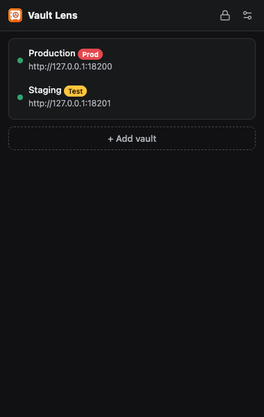
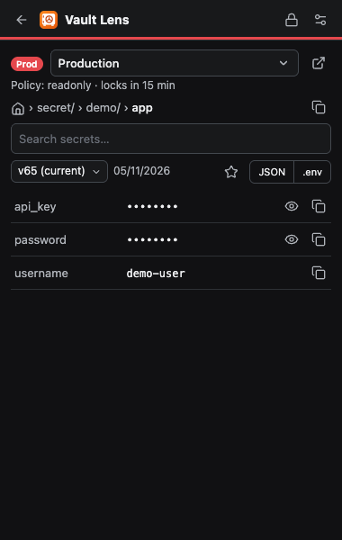
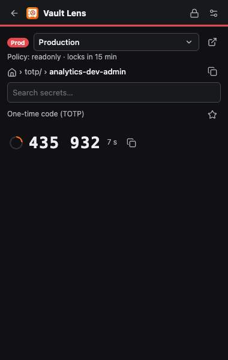
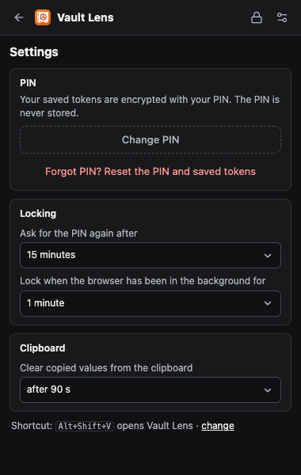

# Vault Lens

A read-only Chrome extension (Manifest V3) for browsing **HashiCorp Vault** KV v1/v2 secrets and TOTP codes across multiple vaults. Add a vault with a read-only token, unlock with a PIN, and browse, search, and copy — without ever running a write.

No build step and no runtime dependencies: plain HTML/CSS/JS (ES modules). The UI is in English and follows the system light/dark theme. Colors come from [Radix Colors](https://www.radix-ui.com/colors) (`extension/vendor/radix-colors.css`, MIT).

> **Vault** is a trademark of HashiCorp. This project is independent and not affiliated with or endorsed by HashiCorp.

| Vaults | Secret | TOTP | Settings |
|---|---|---|---|
|  |  |  |  |

## Why

Vault's own web UI is powerful but heavy for the common case: "I just need to read a value and paste it." Vault Lens lives in the toolbar, keeps your read-only tokens encrypted behind a PIN, and gets you to a secret in a couple of clicks. When you do need to write or administer, one button opens the current path in the vault's real web UI.

## Features

**Multiple vaults**
- Add a vault with a name, address, environment tag (Prod / Test / Dev), and a **token**. The token is verified against the vault (`auth/token/lookup-self`) before it is saved; an invalid token is never stored.
- A connection dot on each vault shows whether it is reachable and the saved token is still valid.
- Quick-switch between open vaults; each vault remembers where you last were.
- Editing keeps the token when only the name/env change; a new address requires a new token.
- If a saved token is rejected by the vault (expired/revoked), the message offers a one-click button to paste a new one — your PIN stays the same.

**PIN and token storage**
- **Tokens are stored encrypted with your PIN** and persist across browser restarts; you only re-enter the PIN.
- **The PIN itself is never stored.** It is set when you add your first vault and is shared by all vaults.
- **Auto-lock:** the unlock lasts a configurable time (default 15 min), plus a background lock when the browser loses focus. A "Lock now" button and a visible countdown are in the header.
- **Wrong PINs:** after 5 wrong attempts the saved tokens are wiped. The counter is serialized across extension pages and survives a browser restart.
- All open extension windows lock and unlock together and stay in sync (a vault deleted or changed in one window can't be used stale in another).
- **Forgot PIN** resets the PIN and saved tokens; the vault list stays.
- A privacy curtain re-masks revealed values when the window loses focus.

**Browsing**
- Auto-discovers KV and TOTP mounts; auto-detects KV v1 vs v2.
- Home screen shows **Favorites**, **Recently opened**, and mounts; breadcrumb navigation and path copy.
- **Search** across every mount in the current vault, by path (case-insensitive), with the matching part highlighted. Values are not searched. The path index is built on first search, kept in memory only while the popup is open, and never written anywhere.
- Reopening the popup resumes where you left off (vault, folder, secret). Location lives in session storage and is cleared when the browser closes.
- **Open in the vault's web UI:** a button next to the vault switcher opens the current page (folder, secret, or KV v2 version) in the vault's own UI in a new tab — for writes and admin. No token is passed along.

**Secret view**
- Known non-secret fields (`username`, `host`, `port`, `url`, `endpoint`, `client_id`, …) are shown; everything else is masked with per-row reveal. URLs that embed credentials are masked too.
- Copy a single value, the whole secret as JSON or `.env`, or the path. The `.env` output is safe to `source`: invalid variable names are skipped and values are single-quoted. Copied values are cleared from the clipboard after a configurable delay (default 90 s), even if the browser is closed first.
- **Version history (KV v2):** read an older version from the last 20.
- A rotation hint appears on secrets not updated for 180+ days.
- **TOTP:** current code, countdown ring, and copy for keys in Vault's TOTP engine.

**Shortcut:** `Alt+Shift+V` opens the extension (configurable at `chrome://extensions/shortcuts`).

## Security model

| Topic | How it is handled |
|---|---|
| Token storage | Tokens live in `chrome.storage.local` **encrypted only** (AES-GCM), bound to the vault address via authenticated additional data, so a stored token cannot be decrypted for another address. The plaintext token exists only in the memory of the page using it. Tokens never appear in logs, URLs, or error text. |
| PIN | Never stored. A 256-bit key is derived with PBKDF2-SHA256 (600,000 iterations, random salt); a wrong PIN fails AES-GCM authentication. Only the salt and a verification blob are persisted. While unlocked, the key lives in `storage.session` (memory) and is dropped on timeout, lock, or browser close. |
| Read-only | A single `request()` function in `vault.js` allows only `GET` and `LIST` and throws on any other method. **The real guarantee is the token's Vault policy** — use a read-only policy (below). |
| Network permissions | No broad `<all_urls>` grant. Access to each vault's host is requested per vault at runtime. Only `https://` is accepted (`http://localhost`/`127.0.0.1` excepted for local dev). No tab or page-content access, no content scripts. |
| Token transport | The token travels only in the `X-Vault-Token` header. Requests don't follow redirects (`redirect: 'error'`), so the token can't be carried to another origin. `.`/`..` path segments from responses are rejected; server error text is prefixed `Vault:` and capped at 200 chars. |
| Clipboard | Copied values are cleared by a background service worker + offscreen page even if the popup is closed. No clipboard read permission. |
| XSS | Secret content reaches the DOM only via `textContent`; no `innerHTML` anywhere. Default MV3 CSP applies. |

### Recommended read-only policy

```hcl
# KV v2 (mount: secret/)
path "secret/metadata/*" { capabilities = ["list", "read"] }
path "secret/data/*"     { capabilities = ["read"] }

# KV v1 (mount: kv/)
path "kv/*" { capabilities = ["list", "read"] }

# TOTP (mount: totp/)
path "totp/keys"   { capabilities = ["list"] }
path "totp/keys/*" { capabilities = ["read"] }
path "totp/code/*" { capabilities = ["read"] }
```

The mount list comes from `sys/internal/ui/mounts`, which Vault's `default` policy allows. Without `default` on your token, the mount list appears empty.

## Install

1. Download a release zip from [Releases](../../releases) (or build one with `npm run package`) and unzip it, or use the `extension/` folder directly for development.
2. Open `chrome://extensions`, enable **Developer mode** (top right).
3. **Load unpacked** and select the folder.
4. Pin the extension from the toolbar.

> Load-unpacked extensions don't auto-update and require Developer mode. For managed fleets, use Chrome enterprise policy or the Chrome Web Store.

## Usage

1. **+ Add vault** → address (e.g. `https://vault.example.com`), then token. On the first vault you also choose a PIN. Approve Chrome's access prompt.
2. Pick the vault from the list. After a restart or a PIN timeout, only the PIN is asked for.
3. Browse mounts → folders → secrets, use Favorites / Recently opened, or press `/` to search.

## Development

Requirements: Node 20+, Docker.

```bash
npm install
npx playwright install chromium   # first time
npm test                          # unit tests (vault.js, format.js, crypto.js)
npm run test:e2e                  # end-to-end tests
```

`npm run test:e2e` is fully automated: it spins up two throwaway dev Vaults in Docker (`127.0.0.1:18200/18201`), seeds each with a read-only token and ~6,600 **fabricated** records (`e2e/seed.js`, `e2e/bulk.js`), loads the extension into Chromium, and exercises every feature — asserting that every request to Vault is a `GET`. Keep the vaults up with `KEEP_VAULT=1 npm run test:e2e`, or run them standalone:

```bash
npm run vault:up     # start the dev Vaults and print read-only tokens
npm run vault:down
```

Tests run against a copy of the extension under `e2e/.build/` with host permission pre-granted (Chrome's permission prompt can't be automated), so the permission flow and real shortcut keys are tested manually.

### Packaging

```bash
npm run package      # runs tests, then dist/vault-lens-<version>.zip (+ .sha256)
npm version patch    # bump version (minor/major too); manifest is synced automatically
```

`package.js` verifies versions match, rejects a manifest with `host_permissions`, requires `key`, allows only `js/html/css/json/png/svg` files, rejects symlinks, and minifies the extension's own JS/CSS with `esbuild` (no bundling; `vendor/` is left intact). Minification shrinks the package only — the code remains readable to anyone who inspects the extension. Test a built package with `E2E_EXTENSION=<unzipped folder> npm run test:e2e`.

The manifest `key` pins a stable extension ID across machines for unpacked installs; it is a public key and safe to commit. The private signing key (`keys/`, gitignored) is only needed to produce a signed `.crx` or to keep that ID — keep it backed up. For the Chrome Web Store, remove `key`; the store assigns its own ID.

### Layout

| Path | Role |
|---|---|
| `extension/manifest.json` | MV3 manifest, permissions, shortcut |
| `extension/vault.js` | Read-only Vault API client (Chrome-agnostic) |
| `extension/store.js` | Vaults/settings/favorites (`storage.local`); token/location (`storage.session`) |
| `extension/background.js` | Service worker: clipboard clearing, background PIN lock |
| `extension/crypto.js` | PIN key derivation + AES-GCM (WebCrypto) |
| `extension/offscreen.*` | Hidden page that clears the clipboard |
| `extension/popup.*` | UI |
| `extension/format.js` | Pure helpers (TTL, `.env`, field type, web-UI URL) |
| `extension/icons*` | Inline SVG icons and the PNG/SVG logo |
| `extension/vendor/radix-colors.css` | Radix Colors scales (MIT) |
| `test/` | Unit tests (`node --test`) |
| `e2e/` | Docker Vaults, seed script, Playwright tests |
| `scripts/` | Packaging and version sync |

## Known limitations

- **Encrypted tokens live on disk.** Anyone with your Chrome profile can brute-force a short PIN offline; the 5-attempt UI limit doesn't stop that. Use a PIN longer than 6 digits, or a passphrase.
- **No protection while unlocked.** During the PIN window (default 15 min) anyone at the machine can read secrets.
- The privacy curtain is dismissible with one click — it guards against glances and screen-sharing, not an attacker. The PIN lock is the real control.
- Token-only auth; no OIDC/LDAP and no Vault Enterprise namespaces.
- Search scans up to 5,000 paths and shows up to 100 results; folders the token can't list are skipped silently.
- KV v2 version history lists the last 20 versions; deleted/destroyed versions can't be read.
- Secret engines other than KV and TOTP (database, PKI, …) aren't supported.

## Contributing

Issues and PRs are welcome. Please run `npm test && npm run test:e2e` before opening a PR, and keep the read-only invariant: nothing in `extension/` may issue a non-`GET` request to Vault.

## License

[MIT](LICENSE)
